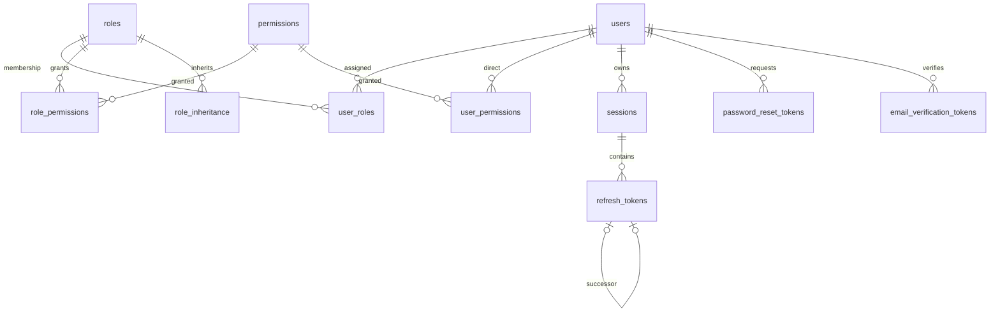

# Phase 2: PostgreSQL persistence and repositories

Historical phase guide. [Phase 3](phase-03.md) now adds authentication and mandatory authentication keys. Follow the root README for current startup and test instructions.

This phase implements persistence. Authentication workflows and API authorization are later phases. Complete TypeScript implementations are in the source files listed below; no placeholder account store, fake production database, or unprotected account CRUD endpoint is introduced.

## Decisions and dependencies

PostgreSQL 17 provides real transactions, foreign keys, composite constraints, partial indexes and database-side hierarchy integrity. TypeORM 1.1.3 provides typed repositories and migrations. TypeORM 1 replaces the older glob dependency and targets modern Node/ES2023; see [the official release notes](https://typeorm.io/blog/typeorm-1-0/) and [upgrade guide](https://typeorm.io/docs/releases/1.0/upgrading-from-0.3/). The project targets ES2023 and requires Node 22.13+ or 24.11+.

`AppModule → CoreModule → DatabaseModule → RuntimeConfigModule`. DatabaseModule exports `DataSource` and `UnitOfWork` as application infrastructure. Users, authorization and sessions modules bind their own repositories to the root manager. Health injects the connection through its database indicator. The entity registry imports metadata classes only, never business services or feature modules. No feature imports the root composition module.

The DataSource is an ordinary Nest factory provider, with a lifecycle provider closing the pool during shutdown. Repositories receive only an explicit `EntityManager`. Transaction scopes construct adapters using the transaction manager; calls after transaction closure are rejected. There is no ambient transaction context or fallback to the global connection. Callers must obtain all participating repositories from the scope and await their operations.

## File structure

The complete tracked source/configuration layout is listed at the end of this guide. Generated output, dependencies, `.env`, `.git` and `.local` are omitted.

## File responsibilities

| Component                           | Responsibility                                                                                                                     |
| ----------------------------------- | ---------------------------------------------------------------------------------------------------------------------------------- |
| `core/config/environment.ts`        | Startup validation/coercion, mandatory database password, bounded pool/timeouts and production TLS requirement.                    |
| `database-config.service.ts`        | Frozen typed connection configuration.                                                                                             |
| `load-cli-config.ts`                | Central `.env`/OS configuration boundary for non-Nest migration/test commands, using the same validator.                           |
| `database.options.ts`               | Shared runtime/CLI/test options; schema sync/drop/automatic migrations and SQL logging disabled; null/undefined criteria rejected. |
| `entities.ts`                       | Explicit entity metadata registry shared by app, migration tooling and tests.                                                      |
| `data-source.ts`                    | TypeORM migration-generation CLI entry.                                                                                            |
| `database.module.ts`                | Single pool initialization and safe failure/shutdown handling.                                                                     |
| `unit-of-work.ts`                   | READ COMMITTED transaction boundary and scoped adapter construction.                                                               |
| `common/persistence/base.entity.ts` | UUID and server-generated timestamps. Mapping tables retain composite keys.                                                        |
| `base.repository.ts`                | Bounded CRUD, lookups, count/existence, safe error translation, filtering/sorting/pagination.                                      |
| `users-repository.interface.ts`     | Application-facing contract and stable `USERS_REPOSITORY` DI symbol. Types represent internal records, not HTTP DTOs.              |
| `typeorm-users.repository.ts`       | Email normalization, explicit credential lookup, literal email search, status/type filters and feature sort allow-list.            |
| `roles.repository.ts`               | Generic role persistence plus hierarchy-edge insertion.                                                                            |
| `permissions.repository.ts`         | Permission persistence using the base repository.                                                                                  |
| `sessions.repository.ts`            | Session persistence and bounded active-session lookup.                                                                             |
| Feature module files                | Bind adapters to the root manager and export providers; no workflow/controller logic yet.                                          |
| Entity files                        | One table per file with explicit types, constraints, indexes and relationships.                                                    |
| Initial migration                   | Twelve tables, foreign keys, indexes/checks and portable `current_database()` generated-column metadata.                           |
| Hierarchy migration                 | Installs/removes the serialized cycle-prevention trigger.                                                                          |
| `database-error.ts`                 | Safe SQLSTATE translation, also used by the global filter for direct ORM failures.                                                 |
| `database-health.indicator.ts`      | Bounded query through the existing pool; requires connectivity and the migrated users table.                                       |
| `scripts/database.ts`               | Development DB creation, migrate/revert/status/schema-check commands, connection cleanup and safe diagnostics.                     |
| `scripts/local-postgres.ps1`        | Optional isolated Windows cluster helper using installed binaries; no service changes/downloads/data deletion.                     |
| `compose.yaml`                      | Alternative local PostgreSQL container with loopback port, volume and health check.                                                |
| Database harness/spec               | Creates/drops only owned databases; tests real constraints, migrations, transactions, races and readiness.                         |

## Normalized schema

| Table                       | Important invariants                                                                                                                                                |
| --------------------------- | ------------------------------------------------------------------------------------------------------------------------------------------------------------------- |
| `users`                     | UUID, unique normalized email, hidden password hash, extensible user type, active/inactive status, email verification, lock expiry and nonnegative failed attempts. |
| `roles`                     | UUID and unique role name.                                                                                                                                          |
| `permissions`               | Constrained resource/action names, unique generated `resource.action` permission name.                                                                              |
| `user_roles`                | Composite user/role primary key; supports multiple roles.                                                                                                           |
| `role_permissions`          | Composite role/permission key.                                                                                                                                      |
| `user_permissions`          | Optional direct grants with composite user/permission key.                                                                                                          |
| `role_inheritance`          | Composite role/inherited-role key; rejects self-edges and transitive/concurrent cycles.                                                                             |
| `sessions`                  | User FK, expiry/revocation, last seen and bounded device metadata; IP/user agent excluded from ordinary selects.                                                    |
| `refresh_tokens`            | Unique SHA-256 digest, expiry/consumption/revocation, session FK; one successor per parent and same-session lineage.                                                |
| `password_reset_tokens`     | Purpose-specific table, user FK, unique digest, expiry and consumption.                                                                                             |
| `email_verification_tokens` | Separate purpose-specific table with the same storage invariants.                                                                                                   |
| `mail_outbox`               | Hidden recipient/ciphertext, template/key ID, retry count, availability, processing state and safe error code.                                                      |

Principal records have UUID/creation/update timestamps; mappings use composite keys and creation timestamps. Deleting a user cascades to dependent memberships, direct permissions, sessions and token rows; role and permission definitions survive. Deleting a parent refresh token cascades to descendants, so retain token history until its session/family has expired and no longer needs replay detection.



The schema does not implement token generation, verification, refresh rotation or atomic single-use consumption; those require phase 3/4 services. SHA-256-shaped storage is only a storage invariant. Permission rows do not enforce API access until guards exist. Outbox callers must encrypt before persistence; encryption/key management and delivery are not yet implemented. No privileged users, real messages or raw tokens are seeded.

Role graph writes acquire one transaction-scoped PostgreSQL advisory lock. A VOLATILE trigger then recursively checks the current graph and rejects cycles. It requires READ COMMITTED: older snapshots under higher isolation could miss a concurrently committed edge after waiting for the lock. This serializes uncommon graph mutations, not ordinary reads. Schema diffs cannot verify PL/pgSQL behavior, so real update/concurrency tests supplement metadata checks.

## Installation and configuration

Installed dependencies: `npm install typeorm@1.1.3 pg dotenv --ignore-scripts` and `npm install --save-dev @types/pg --ignore-scripts`. New checkouts use the committed lockfile with `npm ci --ignore-scripts`.

Windows with installed PostgreSQL binaries:

```powershell
cd E:\ai-saas-api
npm ci --ignore-scripts
npm run db:local
npm run db:migrate
npm run db:schema-check
npm run start:dev
```

The helper defaults to `C:\Program Files\PostgreSQL\17\bin`; use `-PgBinPath` for another installation. It creates a marked cluster in `.local/postgres`, bound to `127.0.0.1:55432`, and validates its fixed settings against existing configuration. Existing database services are untouched. It preserves an existing password, generating one only when none is configured. The fresh-checkout example password is disposable; change it before broader use. The ignored initdb password file and `.env` must stay private. `db:local -- -Action stop` and `-Action start` manage only this cluster.

Docker alternative (do not run both on the same port):

```powershell
Copy-Item .env.example .env
# Choose a local development password in .env.
docker compose up -d --wait
npm run db:migrate
npm run start:dev
```

For an existing server, configure the fields below and skip the local helper.

| Setting               | Default/rule                                                                                                             |
| --------------------- | ------------------------------------------------------------------------------------------------------------------------ |
| `DATABASE_HOST`       | `127.0.0.1`; hostname/IP.                                                                                                |
| `DATABASE_PORT`       | `55432`; valid TCP port.                                                                                                 |
| `DATABASE_NAME`       | `auth_foundation`; lowercase SQL identifier, max 63 chars.                                                               |
| `DATABASE_USER`       | `foundation`; lowercase SQL identifier, max 63 chars.                                                                    |
| `DATABASE_PASSWORD`   | Required, minimum 12 characters; no application fallback.                                                                |
| `DATABASE_SSL`        | False in development; explicitly true in production, certificate validation enabled. Supply a trusted certificate chain. |
| `DATABASE_POOL_MAX`   | 10, bounded 1–100 per process.                                                                                           |
| `DATABASE_TIMEOUT_MS` | 3000, bounded 500–30000; initial/pool connection, driver query and server statement timeouts.                            |

Application code consumes injected configuration; CLI processes use the centralized loader. No connection objects, passwords or query values are logged. Startup requires connectivity and fails with a static safe diagnostic. The pool is closed at shutdown after readiness starts draining.

## Migrations and deployment

```powershell
npm run db:status
npm run db:migrate
npm run db:schema-check
# For a future schema change, inspect generated SQL before applying:
npm run migration:generate -- src/core/database/migrations/DescribeTheChange
```

Pending migrations run transactionally. `db:status` reports pending state; `db:schema-check` fails when entity metadata would generate SQL changes. `db:revert` reverts only the last migration and can remove data. The tests exercise full rollback only in owned disposable databases; the development database is migrated forward. Reverting the initial migration removes all application tables. Do not edit migrations after release; introduce a reviewed forward migration instead.

Runtime schema synchronization, migration auto-run and extension installation are disabled. PostgreSQL's built-in `gen_random_uuid()` provides database UUID defaults without extension installation rights. Run migrations in one deployment job before replicas start. Readiness checks the users table, not the complete migration version; the release job must check pending migrations/schema drift separately.

Production needs a migration owner with DDL rights and a separate runtime role with only schema usage and the necessary SELECT/INSERT/UPDATE/DELETE grants. Apply default grants for future tables. Local/CI owner roles are development-only; test infrastructure needs CREATEDB. Production users/databases are not provisioned automatically. Migration commands currently use `ts-node`, so run a migration job with the development toolchain rather than expecting a production-only npm install to contain it.

## Repository and transaction example

Future application services inject `USERS_REPOSITORY` with the `UsersRepository` interface. Repositories return internal records; HTTP controllers must map explicit response DTOs. Generic ORM update expressions are not exposed by that interface.

Inside an application service with an injected `UnitOfWork`, scoped persistence composition is complete TypeScript:

```typescript
import { Injectable } from '@nestjs/common';
import { UnitOfWork } from '../core/database/unit-of-work';
import { TypeormUsersRepository } from '../features/users/repositories/typeorm-users.repository';
import { SessionsRepository } from '../features/sessions/repositories/sessions.repository';

@Injectable()
export class CreateIdentityAndSession {
  constructor(private readonly work: UnitOfWork) {}

  execute(email: string, alreadyHashedPassword: string) {
    return this.work.run(async (scope) => {
      const users = scope.get(TypeormUsersRepository);
      const sessions = scope.get(SessionsRepository);
      const user = await users.createUser({ email, passwordHash: alreadyHashedPassword });
      const session = await sessions.create({
        userId: user.id,
        expiresAt: new Date(Date.now() + 3600000),
      });
      return { userId: user.id, sessionId: session.id };
    });
  }
}
```

Imports assume a service directly under `src/`. This illustrates persistence, not future registration policy: hashing, verification, token generation and session policy must be enforced by the authentication use case.

`create` uses INSERT, rejecting duplicate IDs instead of save/upsert, then reads the default projection so credentials are excluded. `update` targets one ID and reads the result; missing rows return null. Delete returns a boolean. Write/read pairs use two statements; use a transaction when visibility must be atomic with other operations. Composite mappings retain TypeORM's natural-key API instead of being forced through a fake single-ID base.

`findCredentials` explicitly selects the password hash for the future verifier. Ordinary user reads/list results omit it. Token digests, outbox ciphertext/recipient and sensitive session metadata use `select: false`; secrets are also excluded from class-transformer conversion where defined. A raw ORM save result may still contain supplied secrets. These adapters are internal: `@Exclude` alone does not replace response DTO mapping.

`users.list(query, filters)` supports status, user type, literal email search and `id/email/createdAt/updatedAt` sort fields. SQL LIKE metacharacters are escaped and values parameterized. It returns `{ data, meta }`. The paginator revalidates page/size bounds and adds a unique ID tie-breaker; `findAll` caps results at 100. Filters are typed feature-owned fields, never arbitrary SQL from clients. Null/undefined ORM criteria throw rather than disappear silently.

Known SQLSTATEs become safe application errors: uniqueness → 409 `RESOURCE_CONFLICT`; FK → 400 `INVALID_REFERENCE`; invalid/check/null data → 400 `INVALID_DATA`; serialization/deadlock → 409 `TRANSACTION_RETRY`. No query, submitted value, constraint name or driver detail reaches public errors. Unknown failures retain the existing safe 500 behavior. Retry policy belongs to callers; never blindly replay external side effects. Public auth flows must apply anti-enumeration policies instead of exposing repository conflicts directly.

## API examples

```powershell
Invoke-RestMethod http://127.0.0.1:3000/api/v1/health/live
Invoke-RestMethod http://127.0.0.1:3000/api/v1/health/ready
Invoke-RestMethod http://127.0.0.1:3000/docs/openapi.json
```

Readiness includes `database` and `application` indicators:

```json
{
  "status": "ok",
  "info": { "database": { "status": "up" }, "application": { "status": "up" } },
  "error": {},
  "details": { "database": { "status": "up" }, "application": { "status": "up" } }
}
```

Database loss returns a safe 503 envelope; process liveness remains independent after startup. The check reuses the pool with configured timeouts. There are no users/roles/auth HTTP endpoints yet. Swagger documents only implemented health endpoints.

## Verification, mistakes and performance

```powershell
npm run check:all
npm run db:status
npm run db:schema-check
npm audit
```

There are 48 unit/infrastructure tests and 18 real PostgreSQL tests. Coverage includes migration rollback/reapply and no schema drift; normalization, credential exclusion, duplicate email/ID races; CRUD/pagination/filter/sort/search; undefined criteria; cross-repository rollback and escaped-manager rejection; relationship integrity/cascades; concurrent/update hierarchy cycles and isolation policy; refresh lineage/digest/expiry constraints; purpose-separated tokens; outbox projection; statement timeouts and real HTTP database-loss readiness.

The harness creates fresh `foundation_test_<uuid>` databases on a configured disposable server and drops only those owned names after closing connections. It never resets the application database, refuses production mode, and validates ownership before reset/drop. A naming guard does not replace a dedicated disposable server/account. Infrastructure HTTP tests use a DataSource double; database readiness tests inject the real source. CI provisions PostgreSQL 17 and runs migration/schema checks and the complete suite on Node 22/24. Remote CI has not been executed here.

Indexes cover identity/name lookup, both directions of mapping keys, session/token owners and expiry, users' creation/ID ordering, and pending outbox work. Relationships are not eagerly loaded. Future authorization queries should resolve authority in batches instead of N+1 lookups. No cache is added before revocation/invalidation semantics exist.

The paginator's count and data queries can see concurrent changes under READ COMMITTED; design stable-snapshot reporting separately. Role mutations require READ COMMITTED for their lock protocol. Large offsets and substring email search can scan data: keep caps, measure query plans and add keyset pagination or an appropriate search index when justified. Size pools against the total connection budget across replicas and migration jobs.

Common mistakes: enabling production synchronize, using a root repository inside a transaction, failing to await scoped work, assuming save means insert-only, logging QueryFailedError parameters, accepting arbitrary ORDER BY/filter expressions, returning ORM entities, assuming token storage means rotation is implemented, and running rollback/truncation against a production database.

## Complete file layout

```text
ai-saas-api/
├── .github
│   └── workflows
│       └── ci.yml
├── docs
│   ├── phase-01.md
│   ├── phase-02.md
│   └── roadmap.md
├── scripts
│   ├── database.ts
│   └── local-postgres.ps1
├── src
│   ├── common
│   │   ├── errors
│   │   │   ├── api-exception.filter.ts
│   │   │   ├── application.exception.ts
│   │   │   ├── database-error.spec.ts
│   │   │   └── database-error.ts
│   │   ├── http
│   │   │   ├── response.decorator.ts
│   │   │   └── response.interceptor.ts
│   │   ├── pagination
│   │   │   ├── page-query.dto.ts
│   │   │   ├── page.spec.ts
│   │   │   └── page.ts
│   │   └── persistence
│   │       ├── base.entity.ts
│   │       └── base.repository.ts
│   ├── core
│   │   ├── config
│   │   │   ├── database-config.service.ts
│   │   │   ├── environment.spec.ts
│   │   │   ├── environment.ts
│   │   │   ├── load-cli-config.ts
│   │   │   ├── runtime-config.module.ts
│   │   │   └── runtime-config.service.ts
│   │   ├── database
│   │   │   ├── migrations
│   │   │   │   ├── 1795146450469-InitialIdentitySchema.ts
│   │   │   │   └── 1795146450470-RoleHierarchyIntegrity.ts
│   │   │   ├── data-source.ts
│   │   │   ├── database.module.ts
│   │   │   ├── database.options.ts
│   │   │   ├── entities.ts
│   │   │   └── unit-of-work.ts
│   │   ├── logging
│   │   │   ├── app-logger.service.ts
│   │   │   ├── logging.module.ts
│   │   │   ├── logging.options.ts
│   │   │   └── logging.spec.ts
│   │   └── core.module.ts
│   ├── features
│   │   ├── auth
│   │   │   └── entities
│   │   │       ├── email-verification-token.entity.ts
│   │   │       └── password-reset-token.entity.ts
│   │   ├── authorization
│   │   │   ├── entities
│   │   │   │   ├── permission.entity.ts
│   │   │   │   ├── role-inheritance.entity.ts
│   │   │   │   ├── role-permission.entity.ts
│   │   │   │   ├── role.entity.ts
│   │   │   │   ├── user-permission.entity.ts
│   │   │   │   └── user-role.entity.ts
│   │   │   ├── repositories
│   │   │   │   ├── permissions.repository.ts
│   │   │   │   └── roles.repository.ts
│   │   │   └── authorization.module.ts
│   │   ├── health
│   │   │   ├── database-health.indicator.ts
│   │   │   ├── health.controller.ts
│   │   │   ├── health.module.ts
│   │   │   └── lifecycle.service.ts
│   │   ├── notifications
│   │   │   └── entities
│   │   │       └── mail-outbox.entity.ts
│   │   ├── sessions
│   │   │   ├── entities
│   │   │   │   ├── refresh-token.entity.ts
│   │   │   │   └── session.entity.ts
│   │   │   ├── repositories
│   │   │   │   └── sessions.repository.ts
│   │   │   └── sessions.module.ts
│   │   └── users
│   │       ├── entities
│   │       │   └── user.entity.ts
│   │       ├── interfaces
│   │       │   └── users-repository.interface.ts
│   │       ├── repositories
│   │       │   └── typeorm-users.repository.ts
│   │       └── users.module.ts
│   ├── app.module.ts
│   ├── main.ts
│   └── setup-app.ts
├── test
│   ├── database
│   │   ├── database-harness.ts
│   │   └── persistence.db-spec.ts
│   ├── support
│   │   └── test-application.ts
│   └── foundation.e2e-spec.ts
├── .env.example
├── .gitignore
├── .prettierignore
├── .prettierrc.json
├── compose.yaml
├── eslint.config.mjs
├── jest.config.cjs
├── jest.database.config.cjs
├── package-lock.json
├── package.json
├── README.md
├── tsconfig.build.json
└── tsconfig.json
```
